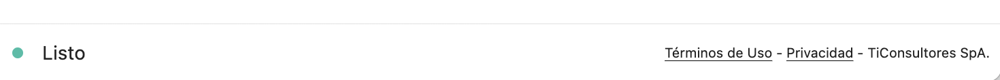
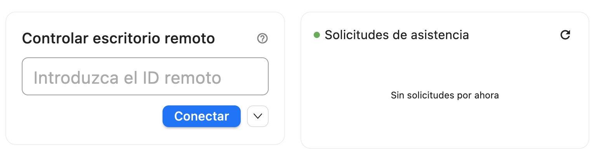
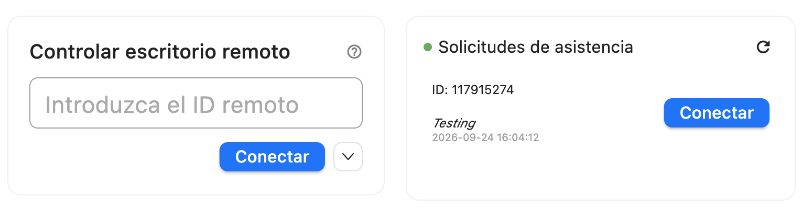

Details are still being finalized, this is *not* the final README
# Índice
1. [Información](#información)

2. [Compilar Rustdesk (Sin Modificar)](#compilar-rustdesk-sin-modificar)

3. [Cambios al Código Original](#cambios-al-código-original)

    - 3.1 [Cambios Generales](#cambios-generales)

    - 3.2 [Aplicar cambios en Windows](#aplicar-cambios-en-windows)

    - 3.3 [Cambios aplicados](#cambios-aplicados)
    
    - 3.4 [Aplicar cambios en MacOS](#aplicar-cambios-en-macos)

    - 3.5 [Cambios aplicados](#cambios-aplicados-1)

# Información
## Soporte-Admin-TIC
Aplicación para técnicos que presten soporte remoto. 

Este proyecto toma a **RustDesk** [](https://github.com/rustdesk/rustdesk) [^1] (1.4.9) como base, añadiendo funcionalidades para el preste de servicios de soporte remoto. 

- Términos de Uso [](https://ticonsultores.cl/terms.html)
- Términos de Privacidad [](https://ticonsultores.cl/privacy.html)

<br>Versiones Específicas:<br>

- RustDesk: <br> commit <`6c578292e8ebbbec708b76986ba8c4bc7c509747`> `Windows`<br> commit <`91c9fccbb0f7bfe5f11644d5fbdec9b23fa10540`> `MacOS` 

(Win)
```bash
6c578292e (HEAD, tag: 1.4.9) bump to 1.4.9
1.4.9-0-g6c578292e
``` 
(Mac)
```bash
91c9fccbb (HEAD -> master, origin/master, origin/HEAD) chore(deps): security bumps in Cargo.lock (RUSTSEC-2026 fixes) (#16143)
nightly-177-g91c9fccbb
```

- hbb_common: <br> commit <`69cea8dafee147848ae88702029f4bf7df7224c3`> `Windows` <br> commit <`29cf7cbe4d38ce36020749f713fb066299f02431`> `MacOs`

(Win)
```bash
libs/hbb_common (driver-310-g69cea8d)
```
(Mac)
```bash
libs/hbb_common (driver-390-g29cf7cb)
```


Para esto se necesitaría seguir las instrucciones del propio repositorio de rustdesk, que mencionaré aquí en caso de que cambien, para compilar la aplicación usando Flutter (No Sciter):

Para efectos prácticos se utilizará la herramienta **Git Bash** [](https://git-scm.com/install/windows) para el cliente de Windows.

Las herramientas base para compilar el programa, obviando la anterior mencionada, serán:
----
## Windows
Herramienta | Versión | Notas
----|----|----|
Visual Studio Community | 2022 (v. 17), workload "Desarrollo para escritorio con C++" | Necesario para MSVC |
Rust(`rustup-innit.exe`) | toolchain `1.75` | El CI de RustDesk fija esta versión para la app |
LLVM | `15.0.6` | Para `bindgen`/`rust-bindgen` |
Flutter SDK | `3.24.5`(canal stable) | **NO** usar `master`/`beta`, RustDesk depende de una verión exacta |
Python 3 | cualquier versión reciente | Para ejecutar `build.py`. <br>En nuestro caso se utilizó la versión `3.11.9` |
vcpkg | commit fijo | Maneja las librerías nativas (`libvpx`, `opus`, `ffmpeg`, etc.)
----

## MacOs
Herramienta | Versión | Notas
----|----|----|
Xcode| La versión mas reciente, mientras sea esta compatible con el OS | En nuestro caso, se utilizó la versión `15.2` (MacOs Ventura 13.7)|
Rust(`rustup-innit`) | `1.75.0` | El CI de RustDesk fija esta versión |
Git | La más reciente | A diferencia de windows, esto es como librería, sin la terminal integrada de git bash. <br>A la fecha (6/Oct/'26): `2.39.3` |
Homebrew | La más reciente | Para instalar los paquetes requeridos. <br>A la fecha (6/Oct/'26): `6.0.19` |
Python 3 | cualquier versión reciente | Para ejecutar `build.py`. <br>En nuestro caso, `3.14.7`. |
vcpkg | commit fijo | Maneja las librerías necesarias (`libvpx`, `opus`, `libyuv`, `aom`) |
Flutter (Vía FVM *(Flutter Version Manager)*) | Flutter: `3.24.5`.<br>FVM: la más reciente | RustDesk depende de una versión de Flutter específica, y FVM permite el manejo entre diferentes versiones.<br> Versión FVM a la fecha(6/Oct/26): `4.3.0` |
----

* Como herramienta adicional para la creación de las imágenes/íconos, se utilizó  **ImageMagick** [](https://imagemagick.org/download/#gsc.tab=0) e  **InkScape** [](https://inkscape.app/es/descargar/), herramientas de código abierto para modificar imágenes y creación de gráficos vectoriales.

# Compilar Rustdesk (Sin Modificar)

Aquí abajo estarán los pasos a realizar para Windows y Mac (Linux en proceso)

<p align="center">
    
    &nbsp;&nbsp;&nbsp;&nbsp;&nbsp;&nbsp;&nbsp;&nbsp;&nbsp;&nbsp;&nbsp;&nbsp;&nbsp;&nbsp;&nbsp;&nbsp;&nbsp;&nbsp;&nbsp;&nbsp;&nbsp;&nbsp;&nbsp;&nbsp;&nbsp;
    
    &nbsp;&nbsp;&nbsp;&nbsp;&nbsp;&nbsp;&nbsp;&nbsp;&nbsp;&nbsp;&nbsp;&nbsp;&nbsp;&nbsp;&nbsp;&nbsp;&nbsp;&nbsp;&nbsp;&nbsp;&nbsp;&nbsp;&nbsp;&nbsp;&nbsp;
    <a href="https://www.home.unix-ag.org/simon/penguin/README" title="Copyright Page of Tux">&copy;</a>
</p>

[^2]

<p align="center">
    <br>[<a href="/docs/ES/COMPILAR_WIN.md">Compilar en Windows (Sin modificaciones)</a>] | [<a href="/docs/ES/COMPILAR_MAC.md">Compilar en MacOS (Sin modificaciones)</a>] | <a href="/docs/ES/COMPILAR_LINUX.md">Compilar en Linux (Sin modificaciones)(WIP)</a>
</p>

# Cambios al código original

A partir de aquí se asume el directorio principal, o 'base', aquel donde se descargue RustDesk, por defecto 'C/rustdesk/'.

## Cambios generales
Cambios que van en todas las versiones (Act. Win & Mac)

**`/src/lang/es.rs`** <br>
Se corrige un error de traducción
```rust
("Untagged", "Sin etiquetar"), // El código original contiene "itiquetar"
```

**`/flutter/lib/common/widgets/connection_page_title.dart`** <br>
Se adapta el código a un segundo `Expanded` para evitar que el panel de conexión no se superponga al panel de notificaciones creado.

```dart
Widget getConnectionPageTitle(BuildContext context, bool isWeb) {
  return Row(
    children: [
      Expanded(
          child: Row(
        children: [
          Expanded (                                     // <-- Desde
            child: AutoSizeText(
              translate('Control Remote Desktop'),
              maxLines: 1,
              overflow: TextOverflow.ellipsis,
              minFontSize: 12,
              style: Theme.of(context)
                  .textTheme
                  .titleLarge
                  ?.merge(TextStyle(height: 1)),
            ).marginOnly(right: 4),
          ),                                            // <-- Hasta aquí es lo que cambia
          Tooltip(
            waitDuration: Duration(milliseconds: 300),
            message: translate(isWeb ? "web_id_input_tip" : "id_input_tip"),
            child: Icon(
              Icons.help_outline_outlined,
              size: 16,
              color: Theme.of(context)
                  .textTheme
                  .titleLarge
                  ?.color
                  ?.withOpacity(0.5),
            ),
          ),
        ],
      )),
    ],
  );
}
```

**`flutter/pubspec.yaml`**
Se añade la ruta explícita del archivo de audio de notificación.

```yaml
# (...)
flutter:
#(...)
    assets:
        - assets/
        - assets/sounds/notification.wav
```
La ruta completa, donde va el audio, es *`/flutter/assets/sound/notification.wav` <br> El audio **debe** ser de nombre *`notification.wav`*

**`/flutter/lib/desktop/pages/connection_page.dart`** <br>
Aquí se incluyen y se modifica el archivo para añadir los módulos originales creados para el presente cliente, los cuales se señalarán en la sección final. <br> Se desactiva la opción de "TCP tunneling" del menú, ya que no se expone ningún servicio de este tipo en el uso previsto del cliente, y su ausencia no afecta el resto del funcionamiento.

```dart
//Importar los archivos nuevos al inicio (~ Ln. 16 - 17)
import 'package:flutter_hbb/desktop/pages/support_notifications.dart';
import 'package:flutter_hbb/desktop/pages/connection_footer.dart';

(...)

@override
  Widget build(BuildContext context) {
    final isOutgoingOnly = bind.isOutgoingOnly();
    return Column(
      children: [
        Expanded(
            child: Column(
          children: [
            Row(
              crossAxisAlignment: CrossAxisAlignment.start,             # <--
              children: [
                Flexible(child: _buildRemoteIDTextField(context)),
                SizedBox(width: 20),                                    # ++
                Expanded(child: SupportNotificationsPanel()), // Módulo nuevo
              ],
            ).marginOnly(top: 22),
            SizedBox(height: 12),
            Divider().paddingOnly(right: 12),
            Expanded(child: PeerTabPage()),
          ],
        ).paddingOnly(left: 12.0)),
        if (!isOutgoingOnly) const Divider(height: 1),
        if (!isOutgoingOnly)                                            # <--, ++
          Row(
            mainAxisAlignment: MainAxisAlignment.spaceBetween,
            crossAxisAlignment: CrossAxisAlignment.center,
            children: [
              Expanded(child: OnlineStatusWidget()),
              ConnectionFooter(), // Módulo nuevo
            ],  
          ),                                                            # <--, ++
      ],
    );
  }

  /// Callback for the connect button.
  /// Connects to the selected peer.
  /// Este bloque habilita el túnel tcp, ahora está comentado y desactivado.
  void onConnect(
      {bool isFileTransfer = false,
      bool isViewCamera = false,
      bool isTerminal = false,
      /*bool isTcpTunneling = false*/}) {
    var id = _idController.id;
    connect(context, id,
        isFileTransfer: isFileTransfer,
        isViewCamera: isViewCamera,
        isTerminal: isTerminal);
        /*isTcpTunneling: isTcpTunneling);*/
  }

(...)

  (
    '${translate('Terminal')} (beta)',
    () => onConnect(isTerminal: true)
  ),
  // `connect` routes this through the
  // desktop path only; the peer card gates
  // it the same way.
  // Este bloque habilita el túnel tcp, ahora está comentado y desactivado.
  /*if (isDesktop)
    (
      'TCP tunneling',
      () => onConnect(isTcpTunneling: true)
  ),*/
 ]
```

**`/flutter/lib/desktop/pages/desktop_home_page.dart`** <br>
Se oculta/comenta el widget de 'ayuda', al igual que el texto de instalación y el botón de actualización, para evitar confusiones volver el proceso más simple y directo. (Este es un proceso compartido con la versión de Windows: en MacOS no genera problemas de desbordamiento, puesto que no se ejecuta en una ventana reducida.)

```dart
Widget buildHelpCards(String updateUrl) {
    /**if (!bind.isCustomClient() &&
        updateUrl.isNotEmpty &&
        !isCardClosed &&
        bind.mainUriPrefixSync().contains('rustdesk')) {
      final isToUpdate = (isWindows || isMacOS) && bind.mainIsInstalled();
      String btnText = isToUpdate ? 'Update' : 'Download';
      GestureTapCallback onPressed = () async {
        final Uri url = Uri.parse('https://rustdesk.com/download');
        await launchUrl(url);
      };
      if (isToUpdate) {
        onPressed = () {
          handleUpdate(updateUrl);
        };
      }
      return buildInstallCard(
          "Status",
          "${translate("new-version-of-{${bind.mainGetAppNameSync()}}-tip")} (${bind.mainGetNewVersion()}).",
          btnText,
          onPressed,
          closeButton: true,
          help: isToUpdate ? 'Changelog' : null,
          link: isToUpdate
              ? 'https://github.com/rustdesk/rustdesk/releases/tag/${bind.mainGetNewVersion()}'
              : null);
    }**/
    if (systemError.isNotEmpty) {
      return buildInstallCard("", systemError, "", () {});
    }
```

**`/libs/hbb_common/src/config.rs`** 
Para que los textos de la UI usen el nombre de la app:
```rust
pub static ref APP_NAME: RwLock<String> = RwLock::new("<NombreDeApp>".to_owned());
```
Y para que se conecte a un servidor personalizado propio
```rust
pub const RENDEZVOUS_SERVERS: &[&str] = &["<IP_SERVIDOR>"];
pub const RS_PUB_KEY: &str = "<KEY_SERVIDOR>";
```

## Aplicar Cambios en Windows
### Cambios aplicados

En esta sección se especifican los cambios realizados para el cliente RustDesk que se hicieron en Windows con efecto de personalizar y/o adaptar el software RustDesk a necesidades específicas. 

Para los íconos, a través de un logo de `1024x1024px`, de fondo transparente en formato `.png`, se realizó el siguiente procedimiento: <br>
*Estas instrucciones asumen el nombre del archivo como 'Logo.png'y que el terminal esté en el mismo directorio de este archivo.* <br>
* *Recordatorio: Git Bash, como su nombre indica, es una terminal de tipo 'Bash', NO confundir con 'Batch' (Windows CMD), puesto que los comandos son distintos para cada entorno.*
```bash
magick Logo.png -background none -resize 32x32 32x32.png
magick Logo.png -background none -resize 64x64 64x64.png
magick Logo.png -background none -resize 128x128 128x128.png
magick Logo.png -background none -resize 256x256 128x128@2x.png
```
Esto genera 4 imágenes, las cuales deben reemplazar aquellas contenidas en la ruta `/res/`.


Para el 'icon.ico' se realizó esto:
```bash
magick Logo.png -background none \( -clone 0 -resize 16x16 \) \( -clone 0 -resize 32x32 \) \( -clone 0 -resize 48x48 \) \( -clone 0 -resize 64x64 \) \( -clone 0 -resize 128x128 \) \( -clone 0 -resize 256x256 \) -delete 0 icon.ico
```
Y para el 'tray-icon.ico' se realizó esto:
```bash
magick Logo.png -background none \( -clone 0 -resize 16x16 \) \( -clone 0 -resize 32x32 \) \( -clone 0 -resize 48x48 \) \( -clone 0 -resize 64x64 \) -delete 0 tray-icon.ico
```
Esto crea copias de distintos tamaños, y luego las junta en el archivo `.ico` necesario.

El primer archivo, `icon.ico`, debe ir en `/flutter/assets` y en `/res/`. El segundo, '`tray-icon.ico`', sólo el `/res/`.

Luego, debe crearse el gráfico vectorial del Logo (`.svg`), usando el programa InkScape.

Para esto, se abre el programa, y dentro de este se abre la imagen del logo (En este caso, `Logo.png`).

<p align="center"> 
    
</p>

Importar con las configuraciones por defecto.

<p align="center"> 
    
</p>

Una vez allí, seleccionar el logo, con el click principal. (Se notará con un recuadro interlineado.)

<p align="center"> 
    
</p>

Ir a la sección 'Trayecto' y seleccionar 'Vectorizar mapa de bits'. *(Dependiendo de la traducción, puede ser 'Trazado' y 'Trazado de mapa de bits' respectivamente)*

<p align="center"> 
    
</p>

En 'Modo de detección', puede variar dependiendo de la imagen, más normalmente con 'Autotrazo' debería funcionar.

<p align="center"> 
    
</p>

Al aplicar se creará el gráfico vectorizado encima de la imagen. Puede identificar cuál es la imagen vectorizada con la información expuesta en la barra de abajo, y en el nombre del archivo generado.

<p align="center">
    
</p>

Ya para finalizar, seleccionar la opción 'Inkscape SVG', escoger la carpeta de destino, ajustar el tamaño para cada `.svg` y exportar la selección.

Los tamaños son:
```
/res/scalable.svg           =>  32x32
/res/logo.svg               =>  26x26
/flutter/assets/icon.svg    =>  1024x1024
```

<p align="center">
    
</p>

----

**`/flutter/pubspec.yaml`** [^3]
```yaml
dependencies:
# (...)
    win32: ^5.10.1 # ~Ln 84
    web_socket_channel: ^2.1.4 # +
    windows_taskbar: ^1.1.2
```
web_socket_channel: Librería para el uso de la función personalizada, en este caso, se encarga de recibir el mensaje de solicitud de asistencia. <br>
windows_taskbar: Se agregó para manejar el parpadeo de atención de la aplicación. <br>
win32: Se fijó una versión específica debido a un conflicto de compatibilidad con las librerías ya mencionadas en esta sección. <br>

**`/flutter/windows/runner/main.cpp`**
```cpp
// ~ Ln 66
    std::wstring app_name = L"Nombre-de-App";
```

**`/flutter/windows/runner/Runner.rc`**
```rc
// ~ Ln. 92 - 98
        BEGIN
            VALUE "CompanyName", "Purslane Tech Pte. Ltd. TiConsultores SpA." "\0"
            VALUE "FileDescription", "Soporte Remoto" "\0" 
            VALUE "FileVersion", VERSION_AS_STRING "\0"
            VALUE "InternalName", "Nombre-de-App" "\0"
            VALUE "LegalCopyright", "Copyright © 2026 Purslane Tech Pte. Ltd. Modifications by TiConsultores SpA. All rights reserved." "\0"
            VALUE "OriginalFilename", "Nombre-de-App.exe" "\0"
            VALUE "ProductName", "Nombre-de-App" "\0"
            VALUE "ProductVersion", VERSION_AS_STRING "\0"
        END
```

**`/flutter/windows/CMakeLists.txt`**
```txt
# ~ Ln. 7
set(BINARY_NAME "Nombre-de-App")
```

**`/libs/portable/Cargo.toml`** 
```toml
[package.metadata.winres]
LegalCopyright = "<CopyrightDeApp>" # Esto es para efecto de clientes personalizados
ProductName = "Nombre-de-App"
OriginalFilename = "Nombre-de-App.exe"
FileDescription = "NombreDeApp"
```

**`/libs/portable/generate.py`**
```py

# ~ Ln. 100
    if not options.executable:
        options.executable = 'Nombre-de-App.exe'
```

**`/src/platform/windows.rs`** <br>
Correlación entre el nombre de la app y el nombre de las funciones.
```rs
// ~ Ln. 1992 - 1993
#[inline]
pub fn get_custom_client_staging_dir() -> PathBuf {
    get_public_base_dir()
        .join("NombreDeApp")
        .join("NombreDeAppCustomClientStaging")
}
// (...)
// ~ Ln. 3750
                if file_name.starts_with("Nombre-de-")  // El comienzo del nombre de la app, no es necesario el nombre completo para distinguirlo de otros archivos.
                    && (file_name.ends_with(".msi") || file_name.ends_with(".exe"))
                {
// (...)
// ~ Ln. 3816
     let caption = "Nombre de App Output"
```

**`build.py`** 
```
# ~ Ln. 456 - 468
    system2(
        f'python3 ./generate.py -f ../../{flutter_build_dir_2} -o . -e ../../{flutter_build_dir_2}/Nombre-de-App.exe') # <--
    os.chdir('../..')
    if os.path.exists('./rustdesk_portable.exe'):
        os.replace('./target/release/rustdesk-portable-packer.exe',
                   './rustdesk_portable.exe')
    else:
        os.rename('./target/release/rustdesk-portable-packer.exe',
                  './rustdesk_portable.exe')
    print(
        f'output location: {os.path.abspath(os.curdir)}/rustdesk_portable.exe')
    os.rename('./rustdesk_portable.exe', f'./Nombre-de-App-{version}-install.exe')                     # <--
    print(
        f'output location: {os.path.abspath(os.curdir)}/Nombre-de-App-{version}-install.exe')          # <--
```


**`Cargo.toml`**
```
[package]
name = "rustdesk"
version = "1.4.9"
authors = ["rustdesk <info@rustdesk.com>" ticonsultores <soporte@ticonsultores.cl>]    #<--
edition = "2021"
build= "build.rs"
description = "Nombre-de-App"                    # <--
default-run = "rustdesk"
rust-version = "1.75"

# (...)
[package.metadata.winres]
LegalCopyright = "Copyright © 2026 Purslane Tech Pte. Ltd. Modifications by TiConsultores SpA. All rights reserved."
ProductName = "Nombre-de-App"
FileDescription = "Nombre-de-App"
OriginalFilename = "Nombre-de-App.exe"
```

## Aplicar Cambios en MacOS
### Cambios aplicados
Los cambios aquí presentes son los que han sido aplicados con efecto de personalizar y/o adaptar el software RustDesk a necesidades específicas.

**`/flutter/macos/Runner/Configs/AppInfo.xcconfig`**
```
PRODUCT_NAME = <NombreDeApp>
PRODUCT_BUNDLE_IDENTIFIER = <tu.identificador.unico>
PRODUCT_COPYRIGHT = Copyright © 2026 Purslane Tech Pte. Ltd. Modifications by TiConsultores SpA. All rights reserved.
```
> `<NombreDeApp>` no debe contener espacios, sólo caracteres alfanuméricos y guiones(`_`, `-`)

**`/flutter/macos/Runner.xcodeproj/project.pbxproj`** — hay 3 ocurrencias hardcodeadas que sobreescriben al `.xcconfig` si no se cambian.
<br>Con esto cambia esas 3 ocurrencias del archivo:
```bash
sed -i '' 's/PRODUCT_BUNDLE_IDENTIFIER = com.carriez.rustdesk;/PRODUCT_BUNDLE_IDENTIFIER = <tu.identificador.unico>;/g' flutter/macos/Runner.xcodeproj/project.pbxproj
```

**`/flutter/macos/Runner/AppIcon.icns`** Este es el ícono que utilizará la `.app`
Para crear uno, se requiere una carpeta del mismo nombre, `AppIcon.iconset` y una imagen del ícono deseado en 10 tamaños.<br>Aquí un pequeño script usando una imagen png del ícono deseado de dimensiones `1024x1024 px`, asumiendo el nombre del ícono `Icon.png`:
```src
mkdir AppIcon.iconset
sips -z 16 16     Icon.png --out AppIcon.iconset/icon_16x16.png
sips -z 32 32     Icon.png --out AppIcon.iconset/icon_16x16@2x.png
sips -z 32 32     Icon.png --out AppIcon.iconset/icon_32x32.png
sips -z 64 64     Icon.png --out AppIcon.iconset/icon_32x32@2x.png
sips -z 128 128   Icon.png --out AppIcon.iconset/icon_128x128.png
sips -z 256 256   Icon.png --out AppIcon.iconset/icon_128x128@2x.png
sips -z 256 256   Icon.png --out AppIcon.iconset/icon_256x256.png
sips -z 512 512   Icon.png --out AppIcon.iconset/icon_256x256@2x.png
sips -z 512 512   Icon.png --out AppIcon.iconset/icon_512x512.png
cp Icon.png AppIcon.iconset/icon_512x512@2x.png
iconutil -c icns AppIcon.iconset
rm -R AppIcon.iconset
```
Puede guardarse como un script, e.g:`CrearIcns.src`, guardarlo en una carpeta junto al `Icon.png`, y en una terminal, ir a la carpeta y ejecutarlo:
```bash
cd Ruta/a/carpeta/del/script
source CrearIcns.src
```
Esto dejará el archivo `AppIcon.icns` en dicha carpeta, teniendo que usarse en la ruta correspondiente (`flutter/macos/Runner/AppIcon.icns`)

**`/res/*.png`**
En esta carpeta se deben ajustar `mac-icon.png`, `mac-tray-dark-x2.png` y `mac-tray-light-x2.png`, esto para una mejor visualización del ícono en la barra de menús.<br>Cada uno tiene un tamaño:


`mac-icon.png` | `mac-tray-dark-x2.png` | `mac-tray-light-x2.png`
----|----|----|
`1024x1024 px` | `60x60 px` | `48x48 px` |


**`build.py`** Se agrega una función para obtener el nombre de la aplicación de forma dinámica.
```python
def get_mac_app_name():
    xcconfig_path = 'flutter/macos/Runner/Configs/AppInfo.xcconfig'
    with open(xcconfig_path, 'r') as f:
        for line in f:
            line = line.strip()
            if line.startswith('PRODUCT_NAME'):
                name = line.split('=', 1)[1].strip()
                return f'{name}.app'
    raise Exception('No se encontró PRODUCT_NAME en AppInfo.xcconfig')
```
y se llama a esta función aquí:<br>
(fragmento)
```python
def build_flutter_dmg(version, features):
    ...

    app_name = get_mac_app_name() # ← Aquí

    os.chdir('flutter')
    
    mac_arch = 'arm64' if platform.machine().lower() in ('arm64', 'aarch64') else 'x86_64'
    system2(
        f'FLUTTER_XCODE_ARCHS={mac_arch} FLUTTER_XCODE_ONLY_ACTIVE_ARCH=YES flutter build macos --release')
        # Para usarse aquí ↓
    system2(f'cp -rf ../target/release/service "./build/macos/Build/Products/Release/{app_name}/Contents/MacOS/"') 
    ...
```

**`/flutter/pubspec.yaml`** Añadir librerías necesarias para el funcionamiento de las adiciones hechas, al igual que indicar la ruta del audio añadido
```yaml
dependencies:
    audioplayers: ^5.2.1
    web_socket_channel: ^2.4.5
(...)

```

**`/flutter/lib/common.dart`**
Forzar la conexión al servidor personalizado
```dart
// should set one by one
  await bind.mainSetOption(
      key: 'custom-rendezvous-server', value: "<IP_SERVIDOR>");
  await bind.mainSetOption(key: 'relay-server', value: "<IP_SERVIDOR>");
  await bind.mainSetOption(key: 'api-server', value: "https://<IP_SERVIDOR>");
  await bind.mainSetOption(key: 'key', value: "<KEY_SERVIDOR>");
```

**`/flutter/lib/desktop/pages/connection_footer.dart`**<br>
Este es un módulo completamente nuevo, el cual sólo añade un 'pie de página', cuya función es informar a los usuarios acerca de los Términos de uso de esta aplicación personalizada y sobre la Privacidad de los datos.


>Adopta el widget de conexión, y al extremo derecho están los enlaces a lo mencionado anteriormente
----

**`/flutter/lib/desktop/pages/support_notifications.dart`**
Este es un módulo, también completamente nuevo, el cual añade una sección a modo de widget en donde se muestran las notificaciones de solicitud de asistencia por orden de llegada, mostrando el ID del solicitante, la hora de la solicitud y un mensaje (opcional) en el cual el solicitante detalla su problemática.


>Así es normalmente, cuando no hay solicitudes
----


>Y así cuando llega una solicitud de asistencia

El botón de reconexión reutiliza *`RefreshWidget`*, ya presente en *`peer_tab_page.dart`*, para la animación de giro. El botón de conexión llama a la función original de RustDesk, sin modificarla.


[^1]: External-link icon created by Dixit Lakhani_02 - Flaticon
[^2]: Por Larry Ewing (<a rel="nofollow" class="external text" href="mailto:lewing@isc.tamu.edu">lewing@isc.tamu.edu</a>) and <a href="https://en.wikipedia.org/wiki/GIMP" class="extiw" title="w:GIMP">The GIMP</a>, Attribution, <a href="https://commons.wikimedia.org/w/index.php?curid=753970">Enlace</a>
[^3]: Utilizo el símbolo '\~' para decir 'Alrededor'. E.g.: "\~ Ln. 84" sería: "Alrededor de la línea 84".
